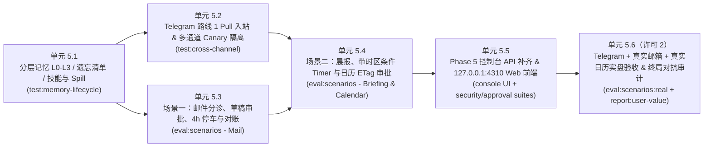

# Phase 5 详细实施与验收规划（多场景、分层记忆、多通道隔离与最小 Web 控制台）

> **编制日期**：2026-11-22（Asia/Hong_Kong）  
> **起始基线**：`0a90526`（`main`，Phase 4 全部单元 4.1–4.5 及终局对抗审计已收口，镜像**纪元 11.5**，15 套离线/容器脚本 + Hono 预检 + `report:user-value` 134/134 全绿，`defaults.json` 全失败关闭）  
> **规范依据**：本机设计包 `D:\AegisPi\aegis-pi-design-pack-v1.4.1` 之 `00`、`01`、`02`、`03`、`04`、`06` 与 `AUDIT-RESOLUTION-MATRIX.md`（`F01`、`F03`、`F08`、`F09`、`F11`、`F14`、`F15`）  
> **文档性质**：阶段规划与分单元实施任务书（经主人 2026-11-22 共同裁定四项核心分叉与路线 1 入站策略，决策留痕 [decision-trail.tsv](../../.audit/decision-trail.tsv) `D-90`）。**本文档本身不构成任何真实外部写、真实邮箱/日历或 Telegram 线上轮询的直接运行授权**；两种许可严格分列。

---

## 一、阶段总体目标与主人已裁定的五项架构前提

Phase 4 已用单向只读仓库分诊（Scenario 4 `repo_triage` + `@aegispibot` 私聊通知）证明了宿主单点持权、容器零信任与 `pi-ai@1.5.2` 单一计费核心的可行性。**Phase 5 的核心使命**是：在不破坏 Phase 4 已验证闭环的前提下，将系统从“单场景单向分诊”扩展为**“具备分域长期记忆（L0–L3）、支持多通道（Telegram 私聊/群聊、真实邮件、真实日历）严格隔离、且配齐浏览器可直接操作的本地 Web 控制台”**的完整个人常驻 Agent 核心。

根据 2026-11-22 主人拍板，Phase 5 全程锁定以下五项设计前提：

1. **Telegram 入站采用「路线 1（`getUpdates` 主动长轮询 Pull 模式）」，D 项（公网入站 Webhook）继续延期且不阻塞后续阶段**：
   - 鉴于当前暂无公网 HTTPS 域名与受信任 TLS 端口资源，Phase 5 的 Telegram 入站统一采用宿主主动出网轮询 `getUpdates`（复用本机 HTTP `CONNECT` 代理隧道，只出不进，零公网暴露端口、零域名依赖）。
   - **D 项（公网 Telegram Webhook）继续延期至主人后续备齐公网 HTTPS 域名/隧道材料之时再单独补充验收**，明确不作为 Phase 5（及后续阶段离线/Pull 闭环）的阻塞前置。
2. **场景一（邮件）与场景二（日历）执行「许可 1 本地环回夹具全闭环 + 许可 2 真实邮箱/真实日历线上实盘验收」双轨制**：
   - 先在许可 1 范围以纯 Node `v22.23.5` 内置网络/TLS 能力实现宿主标准邮件适配器（IMAP over TLS 只读拉取 + SMTP over TLS 审批后发送）与日历适配器（CalDAV over HTTPS + iCalendar `.ics` 解析生成 + `If-Match: <ETag>` 资源版本预条件），并在本地环回夹具套件 `eval:scenarios` 中跑通全部正常/异常/竞争/恢复状态机；
   - 再在单元 5.6（许可 2）接入主人提供的真实测试邮箱、真实测试日历与 `@aegispibot`（私聊 + 测试群）完成端到端线上实盘验收。
3. **在 Phase 5 交付挂载于 `http://127.0.0.1:4310/` 的最小可用 Web 控制台前端页面**：
   - 在补齐 Phase 5 新增后端控制台 API（记忆候选审批/遗忘、Routine 模式切换、对象分页读取、Task Steer、按 `purpose` 归因的 Trace & Budget）的同时，交付浏览器可直接访问与点按操作的本地 Web 控制台（覆盖任务总览、审批卡批准/编辑/拒绝、UNKNOWN 人工对账、记忆候选与 ACL 治理、按 purpose 预算与 Trace、SSE 实时同步），仅将复杂的 `@xyflow/react` 节点拓扑图与 Replay Studio 时间旅行留到 Phase 6。
4. **继续锁定唯一主推理模型 `deepseek/deepseek-flash`（`reasoning: "high"`），按多 `purpose` 独立预留与归因**：
   - 不引入第二个未核验模型 ID；在 `model.allowedPurposes` 与预算账本中正式激活 `router`、`worker`、`summary`、`classify` 四类用途的独立预留、结算与控制台归因统计。
5. **故障隔离与失败关闭铁律（`04` §6 Phase 5）**：
   - [defaults.json](../../apps/daemon/config/defaults.json) 保持 100% 失败关闭：所有新增配置键（`telegram.allowRealPull`、`mail.*`、`calendar.*`）缺省均为 `false` / `null` / `[]`；
   - 任何真实外部写（发邮件、改日历、跨群外发）必须经 `WAITING_APPROVAL` 一次人工 CAS 审批消费（`Auto` 模式同样不豁免外部写审批）；
   - 新增能力一旦出现故障或噪音过高，必须能按 scope 或 Routine **独立退回 `Observe` 或停用**，绝不连累已验收的 Phase 4 仓库分诊闭环。

---

## 二、阶段拆分总览（6 个可独立验收单元：5.1 → 5.6）

为防止“大阶段一口气写完掩盖边界缺陷”，Phase 5 按架构依赖自底向上拆分为 **5 个许可 1 工程单元（5.1–5.5）** 与 **1 个许可 2 实盘验收及终局审计单元（5.6）**：

| 单元 | 核心交付内容 | 许可级别 | 主验收脚本 / 门禁 |
| --- | --- | --- | --- |
| **单元 5.1** | 分域 L0 导出（`MEMORY.md`/`USER.md`）、L1 引用图展开、L2 双 FTS 召回 + 500-token 有界摘要、L3 候选/冲突/过期数据结构（编排循环经 `D-95` 转入第 2 批单元 5.4/5.5）、13 类注入扫描、两阶段遗忘 + 墓碑删除清单（备份恢复重放）、技能三级渐进披露与 50KB Spill | 许可 1（纯离线/本地容器） | `npm run test:memory-lifecycle`（及 `test:restore`、`test:acl` 回归） |
| **单元 5.2** | Telegram 路线 1（`getUpdates` 代理长轮询 + 持久化 `offset` 游标）、按域单飞 Router + 优先级 Aging + `/stop` 控制旁路、跨私聊/群A/群B/多仓库/service 全派生链 9 环节 Canary 隔离 | 许可 1（本地环回夹具） | `npm run test:cross-channel`（及 `test:ingress-telegram` 回归） |
| **单元 5.3** | 场景一（邮件分诊与草稿先行）：IMAP/TLS 只读拉取 + SMTP/TLS 提交子进程、草稿审批卡（To/Cc/Bcc/正文/附件 SHA-256）、4 小时持久停车释放容器、草稿在线编辑换新卡、`AT_MOST_ONCE` 发件箱 `UNKNOWN` 人工对账 | 许可 1（本地 TLS 邮件夹具） | `npm run eval:scenarios`（Scenario 1 邮件矩阵） |
| **单元 5.4** | 场景二（晨间简报与条件跟进 + 日历）：带时区/DST/错过周期合并的条件 Timer、回信与到期竞争 + 提交前二次拦截过时提醒、撤权联动取消 Timer、CalDAV 日历只读简报与 `If-Match: <ETag>` 版本预条件写入审批 | 许可 1（本地 CalDAV 夹具） | `npm run eval:scenarios`（Scenario 1 + 2 全矩阵） |
| **单元 5.5** | Phase 5 控制台后端 API（`/api/memory/*`、`/api/routines/:id/mode`、`/api/objects/:id`、`/api/tasks/:id/steer`、分 `purpose` Trace & Budget）+ **挂载于 `127.0.0.1:4310/` 的最小可用 Web 控制台前端页面** | 许可 1（本地 HTTP/SSE/UI 契约） | `test:security:unit`、`test:cancel-approval` 及浏览器端到端操作核验 |
| **单元 5.6** | **受控线上实盘验收**：① `@aegispibot` `getUpdates` 私聊+测试群隔离；② 真实测试邮箱 IMAP 拉取→草稿→Web 控制台审批→SMTP 发送；③ 真实测试日历 CalDAV 简报+`ETag` 写入审批；④ `/poteto-mode` 终局对抗审计与全量回归 | **许可 2**（需首跑检查表与环境变量门禁，缺省 `exit 4`） | `npm run eval:scenarios:real` + `npm run report:user-value` |

---

## 三、各单元详细设计、产物清单与验收标准

### 单元 5.1：分层记忆（L0–L3 / Dreaming）、撤权遗忘传播与技能渐进披露

#### 1. 设计与实施要点（对应规范 `01` §3–7、`06` §2、审计矩阵 `F08`/`F09`）
- **L0 分域不可变导出与会话内快照冻结**（新增 `apps/daemon/src/memory.mjs`）：
  - 每个 scope 独立维护 L0 记忆，导出至 `workspace-state/scopes/<scope-id>/MEMORY.md`（默认起点上限 `2200` 字符）；仅 `owner_dm` 域允许维护个人偏好 `USER.md`（默认起点上限 `1375` 字符）。**严禁全局共享 `USER.md`，严禁将私聊 `USER.md` 注入群聊、仓库或 `kind='service'` 运维域**。
  - 文件落盘严格遵守 `06` §9 崩溃矩阵：先写临时文件 → `fsync` → `rename` → 父目录同步，再在 SQLite 事务中激活 `objects(kind='l0_memory' | 'l0_user')` 引用。
  - 会话（Attempt/Session）启动时冻结 L0 快照哈希以保持 KV 前缀稳定；普通事实更新在下一 run 生效，但**紧急更正、撤权（`authorization_revision` 变化）或安全规则变更必须立即中止旧上下文并建立新 session**。
- **L1 引用图有界展开与 L2 双 FTS 授权召回 + 有界摘要**：
  - L1：沿 `object_edges` 展开关联任务/邮件/PR 引用链，每一跳必须先验证调用者拥有目标对象全部 `object_required_scopes` 读权限，限制 `maxHops`（默认 2）与最大展开对象数（默认 16）。
  - L2：调用已锁定 [recall.mjs](../../apps/daemon/src/recall.mjs)（`RECALL_SQL` 先在 `allowed` CTE 内完成 scope/ACL/active/有效期/祖先链过滤，再走双 FTS `LIMIT 40` 与 RRF `LIMIT 12`；`<3` 字符短词走 `recallShortTerm` 有界 `LIKE` 回退）。
  - 有界摘要：使用 `purpose='summary'` 预留预算（初始上限 `500` 输出 token），强制保留否定词、条件、路径、SHA 与证据引用；摘要生成的派生对象在同一事务内写入**全部父来源 `object_required_scopes` 的并集闭包**（读权限取交集，绝不“摘要后自动脱密”）。
- **候选记忆（`candidate`）、冲突检测（`conflicted`）与 L3 Dreaming**：
  - 模型抽取只允许写入 `objects(kind='memory_fact', status='candidate')`，必填 `source_uri`、`source_actor`、`observed_at`、`confidence`、`expires_at`、`version`、`supersedes_id` 与 `metadata_json`（事实键 `factKey` 与确认依据）。
  - **硬禁区**：涉及身份、收件人、支付、审批豁免或权限变更的候选条目**一律禁止自动激活**，且权限变更绝不走记忆接口。
  - 同一 `(scope_id, factKey)` 出现相斥值时，将新旧候选标为 `status='conflicted'` 并保留双版本供主人裁决，绝不按“最后一次文本”静默覆盖。
  - **L3 Dreaming（`D-95` 范围切分）**：单元 5.1 仅落地 `candidate`/`conflicted`/`expires_at` 数据结构与提议/激活/冲突原语；**L3 Dreaming 编排调度循环**（静默时段触发、独立预算预留、候选合并提议、冲突告警生成、定期过期归档）正式转入**第 2 批单元 5.4 / 5.5**（与 `quietHours`、Timer 调度及记忆治理台合并落地）。
- **13 类纵深注入扫描器**（新增 `apps/daemon/src/memory-scanner.mjs`）：
  - 对进入候选记忆、L0、技能描述与外部摘要的文本执行 13 类确定性扫描：①零宽字符、②BiDi 控制符、③Unicode Tags、④ANSI 转义序列、⑤隐藏 HTML/注释、⑥角色边界伪造标签（如伪造 `<system>`/`RequestScope`）、⑦覆盖指令祈使句、⑧宿主秘密路径、⑨外发命令、⑩超长 Base64/Hex 编码块、⑪网关/代理改写指令、⑫审批豁免声称、⑬容量超限。
  - 命中项不损坏原始证据对象，但强制阻断其进入 `active` L0，并打上 `quarantined_reasons` 标记交控制台人工核验。
- **两阶段遗忘与受保护墓碑删除清单（Tombstone Deletion Manifest）**：
  - **第一阶段（停止使用）**：在单事务内将目标对象置为 `status='deleted', deleted_at=now`，同步删除 `session_messages_index` 对应行（触发 `trg_msg_ad` 清理 `fts_messages_lex` 与 `fts_messages_tri`），并沿 `object_edges` 递归查找全部下游派生对象（摘要、L0 快照、报告）：独享派生物一并置 `deleted`，共享派生物撤下并标记需重生成。
  - **第二阶段（物理清除与墓碑清单）**：清理对应的对象磁盘文件、spill 文件、session fork 检查点与 L0 导出文件；在确认删除前，将不含敏感正文的墓碑事件（`deletionSeq`、`objectId`、`contentHash`、`scopeId`、`deletedAt`）追加写入独立于普通数据库备份的受保护删除清单 `workspace-state/deletion-manifest.json`（带 HMAC/SHA-256 链式校验与副本备份）。
  - **备份恢复防复活（升级 [backup-window.mjs](../../apps/daemon/src/db/backup-window.mjs) 与 [recovery.mjs](../../apps/daemon/src/recovery.mjs)）**：从一致性备份恢复时，必须先读取并校验最新 `deletion-manifest.json`：若删除清单缺失或清单序号低于数据库已知最大删除序号，恢复流程**拒绝开放对外执行，强制停在只读隔离诊断模式（`exit 3`）**；若校验通过，则在开放服务前自动重放墓碑清单，物理抹除旧备份中已被遗忘的对象与 FTS 索引。
- **技能三级渐进披露与 50KB 可恢复 Spill**（新增 `apps/daemon/src/skills.mjs`、`apps/daemon/src/spill.mjs`）：
  - 技能按「一级：名称与简短索引 → 二级：SKILL 正文 → 三级：经人工审查锁定的脚本 hash」按需加载；Task 创建时锁定 `skill_set_hash`，运行中绝不因候选更新而热切换。
  - 工具/读取输出超过 `50 KB` 或 `2000 行` 时，宿主自动将完整原文写入当前 scope 隔离的 `objects(kind='tool_spill')`（必须先脱敏凭据再落盘），向模型仅返回截断视图（代码/文档保留头部，编译/测试日志保留尾部与关键错误）+ `spillObjectId`；模型仅能通过受 ACL 检查的 `object_id + offset/limit` 分页读取，绝不暴露宿主文件路径。

#### 2. 单元 5.1 验收标准（新增 `evals/phase5/memory-lifecycle/run.mjs`，脚本名 `npm run test:memory-lifecycle`）
1. **L0 分域隔离与原子导出**：验证 `owner_dm`、`group`、`repo`、`service` 四类域的 L0 导出互不串读；`service` 与 `group` 域无法读取 `USER.md`；会话内修改普通事实不破坏当前 run 的 L0 前缀哈希，下一 run 才可见。
2. **L1/L2 派生闭包与 45 条无权干扰回归**：跨两个私密 scope 生成的摘要自动要求双 scope 读权限（缺少任一 scope 权限的调用者读取返回拒绝）；注入 45 条高词频跨域/无权/当前会话祖先链记录，验证 `recall()` 与 `<3` 字符短中文 `recallShortTerm()` 仍准确返回合法的 12 条以内授权结果。
3. **候选、冲突与 13 类注入隔离**：验证 13 类注入载荷逐一被拦截在 `candidate` 隔离态；相斥事实自动标 `conflicted` 双版本并存；试图通过记忆候选写入“免审批/改收件人白名单”被确定性规则直接拒绝。
4. **撤权即时换上下文**：在途会话包含某对象时，模拟宿主撤销对应 `acl_grants`（`authorization_revision` +1），下一次模型请求/工具调用前立即终止旧 session 并以剔除该对象后的干净上下文重建。
5. **级联遗忘与备份恢复重放删除清单**：对一条已被摘要、L0 导出、FTS 索引和 spill 引用的源对象执行 `forget`，验证源对象、派生摘要、FTS 词条、L0 文件与磁盘 blob 全部清除；随后将数据库回滚到遗忘前的一致性备份并启动恢复，验证恢复器自动重放 `deletion-manifest.json` 彻底清除复活数据，且当人为损坏或回退 `deletion-manifest.json` 序号时，daemon 拒绝开放执行并停在只读维护态。
6. **技能固定版本与 50KB Spill 边界**：运行中 Task 在新技能激活后仍保持原 `skill_set_hash`；超 50KB 输出生成受 ACL 保护的 spill 对象，跨 scope 主体请求该 `spillObjectId` 被拒。

---

### 单元 5.2：Telegram 路线 1（`getUpdates` 长轮询入站）与场景三多通道 Canary 隔离

#### 1. 设计与实施要点（对应主人路线 1 决定、规范 `01` §1–3、`03` §5、审计矩阵 `F01`/`F14`）
- **Telegram `getUpdates` 主动长轮询入站运行时**（升级 [ingress-telegram.mjs](../../apps/daemon/src/ingress-telegram.mjs)、新增隔离拉取子进程 `apps/daemon/src/ingress-telegram-child.mjs` 并接入 [daemon.mjs](../../apps/daemon/src/daemon.mjs)）：
  - **配置失败关闭**：在 `defaults.json` 的 `telegram` 节新增 `allowRealPull: false`、`pullIntervalMs: 5000`、`pullTimeoutSeconds: 0`、`pullBatchLimit: 20`、`allowedChatIds: []`。非环回 `apiBase` 必须同时满足 `allowRealPull=true`、非空 `allowedChatIds` 与未吊销 `"im"` 凭据槽位，否则零网络调用。
  - **代理与密钥隔离**：`ingress-telegram-child.mjs` 通过 `stdin` 接收 `{ apiBase, botToken, proxyUrl, offset, limit, timeoutSeconds }`，复用 `upstream-telegram-child.mjs` 的一次性 `HttpAgent`/`HttpsAgent` HTTP `CONNECT` + TLS 隧道、清洁环境变量 `buildSafeChildEnv()` 与全路径 token 脱敏。
  - **持久化游标（At-Least-Once 拉取 + 幂等入库）**：
    - 从 `system_state(key='telegram_pull_offset')` 读取当前 `offset`；
    - 对返回的每条 `update`，先验证 `message.chat.id` 是否命中 `telegram.allowedChatIds`（未命中则仅记脱敏安全计数，**不持久化消息正文、不建 Task**）；
    - 命中白名单的 `update` 调用 `mapTelegramUpdate` 映射为 `dm:telegram:<chatId>`（`kind='owner_dm'`）或 `group:telegram:<chatId>`（`kind='group'`），在单事务内经 `receiveEvent` 写入 payload 对象、`inbox`（靠 `UNIQUE(source, source_event_id)` 天然幂等去重）、准入审计与 stream event；
    - **只有当本批全部 update 的入库事务提交成功后**，才更新 `system_state.telegram_pull_offset = maxUpdateId + 1`。即使在拉取后、更新 offset 前崩溃，下次重启重拉同一 `update_id` 也会被 `inbox` 唯一索引无损幂等吸收。
- **按域单飞 Router、优先级 Aging 与确定性控制指令旁路**（升级 [router.mjs](../../apps/daemon/src/router.mjs)、[scheduler.mjs](../../apps/daemon/src/scheduler.mjs)、[daemon.mjs](../../apps/daemon/src/daemon.mjs)）：
  - **确定性控制旁路（`06` §3.1）**：入站文本若匹配 `/stop`、`/status`、`/pause`、`/resume`，宿主在验证 `principal_id` 对该 scope 的权限后**直接走确定性代码控制路径并记审计**（例如 `/stop` 直接触发该 scope/task 的 `cancelTask`），绝不排队等待慢模型推理。
  - **按域单飞与批次合并（`01` §2）**：同一 `scope_id` 的 Router 推理严格单飞；在途期间到达的同域 `PENDING` 事件在下一轮按 `effectivePriority = basePriority + floor(waitMs / agingStepMs)` 排序合并（单批最多 8 条且受 `maxInputBytes` 约束），并限制单 scope 连续抢占轮次（防止高频群聊饿死私聊或仓库任务）。
  - **同域线程直投防扩权**：复用已有 `(scope_id, thread_key, task_id)` 订阅直投时，强制核验新事件 `principal_id` 权限、Task 状态、`scope_epoch` 与事件 ACL；新事件只能保持或收紧权限，话题切换或权限不兼容时另建新 Task。
- **场景三：跨私聊 / 群聊 / 仓库全派生链 Canary 隔离（CP1–CP4 闭环）**：
  - **群内主人身份不继承私聊权限（CP1/CP2）**：哪怕发言人的 `principal_id` 是主人本人，只要当前任务运行在 `group:telegram:<groupId>` scope，其上下文装配、L0 读取、L1 图展开、L2 FTS 召回、spill 读取与 session fork 均**严格锁死在当前群 scope 的授权闭包内**，无法读取 `dm:telegram:<owner>` 或未授权 `repo` 的任何对象。
  - **输出目标接收人反向校验（CP4）**：在提案建行（`proposeEffect`）与分发提交（`dispatchEffect`）前，宿主不仅检查发起人读权限，还强制追踪载荷完整上游 `object_required_scopes` 闭包（含 `object_edges` 全祖先，深度超限必须失败关闭而非静默放行），并反向校验**目标接收域（含 `group:telegram:<id>`、无前缀 `telegram:<id>`、第三方 `dm:*`、带跨私域闭包的同域目标，以及第 2 批 `mail.send`/`calendar.write`）**是否被允许接收全部闭包 scope；**`adapters.allowedRecipients` 仅代表传输可达白名单，绝不自动视作跨私域披露授权**（跨私域披露须经 `system_state.disclosure_allowlist` 人工审查记录或目标确为对全闭包均有活读权限的单人 `owner_dm`）；一旦检测到未授权披露，立即在建行/提交前以 `cp4_recipient_scope_leak_blocked` 拒绝并记审计告警。

#### 2. 单元 5.2 验收标准（新增 `evals/phase5/cross-channel/run.mjs`，脚本名 `npm run test:cross-channel`）
1. **Telegram Pull 游标持久化与崩溃幂等**：本地环回 Telegram 服务 + 本地 `CONNECT` 代理下，验证 `getUpdates` 正常拉取私聊与群聊消息、未授权 `chat_id` 零正文入库、模拟在 `receiveEvent` 提交后 / `telegram_pull_offset` 更新前崩溃重启，验证重启后重拉同批 `update_id` 零重复 Task、游标最终准确推进。
2. **全派生链 9 环节 Canary 零泄漏矩阵**：在 `dm:telegram:owner` 植入高熵秘密 Canary，依次驱动：①Router 历史拼接、②Worker 上下文装载、③L0 `MEMORY.md`/`USER.md` 导出、④L1 `object_edges` 引用图展开、⑤L2 双 FTS 与短词 LIKE 召回、⑥`purpose='summary'` 压缩摘要、⑦50KB 工具 Spill 分页读取、⑧Session Fork 检查点恢复、⑨Outbox/Adapter 跨群发送；在 `group:telegram:A`、`group:telegram:B`、`repo:gh/a/b` 与 `service:ops` 全部 9 个环节断言 Canary 命中数为 **0**（含主人在群 A 内发消息要求“总结我私聊里的内容”被 CP2/CP4 双重拦截）。
3. **撤权即时失效与单飞公平调度**：群 A 撤权后旧 session 立即作废；人为构造群 A 高频刷屏与慢 Router 阻塞，验证私聊 `/stop` 控制指令秒级直接生效，且低优先级域通过 aging 增益在有界轮次内获得执行。

---

### 单元 5.3：场景一（邮件分诊与草稿先行、4 小时持久停车与发件箱对账）

#### 1. 设计与实施要点（对应主人决定 `A1`、规范 `03` §3、`02` §4、`04` §2、`06` §4–6）
- **零新增依赖的宿主邮件适配器**（新增 `apps/daemon/src/mail-adapter.mjs` 与隔离短命子进程 `apps/daemon/src/upstream-mail-child.mjs`）：
  - **默认配置失败关闭（`defaults.json` 新增 `mail` 节）**：
    - `imapHost: null`、`imapPort: 993`、`imapTls: true`、`smtpHost: null`、`smtpPort: 465`、`smtpTls: true`、`allowRealMailRead: false`、`allowRealMailSend: false`、`allowedFolders: ["INBOX"]`、`allowedSenders: []`、`allowedRecipients: []`、`approvalTtlMs: 14400000`（默认 4 小时）、`maxAttachmentBytes: 4194304`。
  - **凭据与进程隔离**：邮箱账号与专用密码（App Password）仅存本机 `.env` 并经宿主凭据槽 `"mail"` 解析，通过 `stdin` 传给无环境变量密钥的 `upstream-mail-child.mjs`；子进程使用 Node 内置 `node:tls` / `node:net` 执行最小确定性 IMAP 只读命令（`LOGIN` → `SELECT INBOX` → `UID FETCH` 头/正文/附件哈希）与 SMTP 发送命令（`EHLO` → `AUTH PLAIN/LOGIN` → `MAIL FROM` → `RCPT TO` → `DATA`），全程禁止模型拼接命令或服务器地址，错误输出先脱敏凭据后截断。
  - **最小指针入库与身份防伪**：入站邮件创建 `scope: dm:mail:<account>`（或按 thread 隔离），只保存邮件指针、`Message-ID`、`In-Reply-To`/`References` 构成的 `thread_key`、真实发件人信封地址、脱敏正文摘要与附件 `sha256` 清单；**绝不将 `From` 显示名当作真实指令身份，绝不把整邮箱灌入全局记忆**；群聊任务绝不能借邮件 `thread_key` 继承私聊邮箱权限。
- **草稿先行、4 小时持久停车释放容器与编辑重审闭环**（新增 `apps/daemon/src/mail-triage.mjs` 并联动 [approvals.mjs](../../apps/daemon/src/approvals.mjs)、[effects.mjs](../../apps/daemon/src/effects.mjs)）：
  - Agent 结合当前邮件线程与授权日历/L1 背景生成回复草稿及支持依据后，向宿主提议 `mail.send` 动作；
  - 宿主在单事务内：
    1. 校验收件人（`To/Cc/Bcc` 必须全部在允许范围或原线程已验证范畴）、发送身份 `fixedSendingIdentity`、正文哈希与附件 `sha256`；
    2. 创建 `effects(operation='mail.send', state='WAITING_APPROVAL', retry_mode='AT_MOST_ONCE')` 与 `approvals(state='WAITING', expires_at=now + approvalTtlMs)`；
    3. **将 Task 置为 `WAITING_APPROVAL`、当前 Attempt 置为 `PARKED`、清空运行租约 `lease_owner/lease_expires_at`（不递增 `fence`），并立即关闭和回收 Agent 工作容器**（等待审批的 4 小时期间零容器占用、零模型消耗，且支持跨越 daemon 重启持久保持 `PARKED`）。
  - **审批决策与编辑换卡**：
    - **批准（`approve`）**：CAS 消费审批卡（`WAITING → CONSUMED`），effect 转 `READY`，Task 转 `WAITING_EFFECT`，由宿主 Dispatcher 经 `upstream-mail-child.mjs` 发送；
    - **编辑后重确认（`revise`）**：用户修改收件人、主题或正文后，调用 `reviseEffect` 生成**全新 `effect`、`business_key` 版本、`action_hash` 与新 `WAITING` 审批卡**，原审批卡立即置 `INVALIDATED`（严禁旧批准覆盖新正文）；
    - **拒绝或 4 小时超时（`reject` / `EXPIRED`）**：正常结束任务，**绝不自动重试，绝不换用 Telegram 等其他通道强行补发**。
  - **`AT_MOST_ONCE` 与 `UNKNOWN` 发件箱对账**：由于 SMTP 协议在 `DATA` 发送后断流无法保证远端幂等，任何提交后超时/崩溃一律保持 `effects.state='UNKNOWN'` 并停止自动重发；必须由管理员核查发件箱回执后调用 `POST /api/effects/:id/reconcile`（传入 `externalEvidenceRef` 置为 `CONFIRMED_SUCCESS` 或 `CONFIRMED_NOT_SENT`），确需重发时必须作为带重复风险说明的新动作发起。

#### 2. 单元 5.3 验收标准（纳入 `evals/phase5/scenarios/run.mjs`，脚本名 `npm run eval:scenarios`）
1. **本地 TLS IMAP/SMTP 夹具全流程**：拉取含附件的测试邮件 → 校验 `From` 显示名伪造主人指令被拒 → 生成草稿进入 `WAITING_APPROVAL` 且 `attempt=PARKED`、容器已释放 → 模拟 daemon 重启后待审卡完好无损 → 批准后 SMTP 准确投递 1 封且 `external_id` 入账。
2. **草稿编辑、双击与越权拦截**：编辑草稿正文后旧 `approvalId` 点击批准返回 `409`；双击批准仅消费一次；篡改附件内容（`attachment_hash` 失配）或含未授权 `Cc/Bcc` 收件人在 CP4 门禁直接拒绝；群聊任务试图读取邮件线程原文被 CP2 拒绝。
3. **超时/驳回不换通道与 `UNKNOWN` 对账**：审批超时（4 小时模拟拨钟）或被拒后，Outbox 零重发；模拟 SMTP `DATA` 阶段断流进入 `UNKNOWN`，验证 daemon 拒绝自动重发，直至传入 `externalEvidenceRef` 完成 `reconcile`。
4. **场景一价值评估产物**：测试报告自动核算免改批准率、编辑保留率（剔除放弃/未发混淆）、错收件人/漏附件拦截数与耗时对比。

---

### 单元 5.4：场景二（晨间简报、带时区条件跟进 Timer 与日历版本预条件审批）

#### 1. 设计与实施要点（对应主人决定 `A1`、规范 `03` §4、`06` §7、审计矩阵 `F04`）
- **带时区条件跟进 Timer 与“回信 vs 到期竞争”双保险**（升级 [timers.mjs](../../apps/daemon/src/timers.mjs) 与 `apps/daemon/src/briefing-followup.mjs`）：
  - **真实跟进条件求值器**：在 `evaluateCondition` 中新增 `{ type: "contact_no_reply", threadKey, expectedSender, sinceMs }`。扫描 `inbox` 与邮件/IM 记录时，**自动剔除机器人自身回执（`source_actor=bot`）、主人自己发出的消息以及自动退信/系统通知**；只有目标联系人本人在 `threadKey` 产生有效回复才判定 `satisfied: true`。
  - **IANA 时区、夏令时（DST）与重启合并补跑**：Timer 显式绑定 IANA 时区（默认 `Asia/Hong_Kong`，并支持带夏令时时区如 `America/New_York` 的本地挂钟时间换算）；daemon 停机重启遇到跨多个周期未触发的周期性晨报/跟进 Timer 时，严格合并为**单次补跑**并如实记录 `missed_count`，禁止开机无限追赶轰炸。
  - **回信与到期竞争事务 + 提交前二次重验**：
    - 到期扫描与收到联系人回信由同一 SQLite `BEGIN IMMEDIATE` 事务顺序裁决（先提交者胜）；
    - 即使 Timer 到期先赢并生成了 `notify_reason='followup:<timerId>'` 的 `READY` 提醒 effect，在宿主 Dispatcher 真正向外发通知前，`cancelSatisfiedFollowUpReminders` 再次重核条件——若此时联系人回信已入库，立即将该 `READY` 提醒置为 `CANCELLED`（记 `stale_reminder_cancelled` 审计），消灭过时打扰。
  - **撤权与取消级联**：当任务被取消、scope 被暂停或对应邮箱/IM 读权限被撤销时，同事务自动将该 scope 下关联的 `SCHEDULED` Timer 置为 `CANCELLED`。
- **CalDAV 日历只读简报与 `If-Match: <ETag>` 资源版本预条件写入适配器**（新增 `apps/daemon/src/calendar-adapter.mjs` 与 `apps/daemon/src/upstream-calendar-child.mjs`）：
  - **默认配置失败关闭（`defaults.json` 新增 `calendar` 节）**：`caldavUrl: null`、`allowRealCalendarRead: false`、`allowRealCalendarWrite: false`、`allowedCalendars: []`、`defaultTimezone: "Asia/Hong_Kong"`、`quietHours: { start: "23:00", end: "07:00", timezone: "Asia/Hong_Kong" }`。
  - **只读晨间简报**：按授权拉取当日/未来窗口 `.ics` 事件（解析 `DTSTART`/`DTEND`/`TZID`/`RRULE`/`SUMMARY`/`ATTENDEE` 及 `ETag`），结合待审草稿、待跟进 Timer 与未恢复基础设施告警生成结构化晨报；遵守静默时段（`outbox.not_before`）与合并取代（`supersedes_outbox_id`），但**持续基础设施故障绝不因静默规则被永久隐藏**。
  - **日历修改（一次审批 + `ETag` 预条件）**：日历新增/改期绝不作为只读简报自动执行，必须生成 `operation='calendar.write'` 的审批卡，并在 `action_json.expected_head` 中绑定读取时的远端 **`ETag`**；审批通过后宿主子进程发送 `PUT / DELETE` 时携带 HTTP 头 `If-Match: "<expected_head>"`。若远端日程已被外部并发修改（返回 `412 Precondition Failed` 或 `headPrecondition` 校验失配），立即走 `reproposeHeadChanged` 使旧卡失效并提示用户按最新日程重审，绝不静默覆盖冲突日程。
- **L3 Dreaming 编排调度循环（由单元 5.1 经 `D-95` 正式转入本批）**：复用本单元的 IANA 时区 `quietHours` 调度与 `purpose='summary'` 独立预算预留，实现低频后台整理循环：自动扫描 `expires_at <= now` 记忆归档为 `status='expired'`、对同域相似 `candidate` 提议合并（不直接绕过人工激活，也不碰 `NEVER_ACTIVATABLE_CATEGORIES`）、对久未裁决的 `conflicted` 记忆生成治理告警（交单元 5.5 控制台处理）。

#### 2. 单元 5.4 验收标准（纳入 `evals/phase5/scenarios/run.mjs`，脚本名 `npm run eval:scenarios`）
1. **条件 Timer 过滤与竞争闭环**：验证机器人回执、主人自发消息不会误触发 `SATISFIED`；真联系人回信在 Timer 到期前到达 → Timer 转 `SATISFIED` 零提醒；Timer 到期先赢生成 `READY` effect、但发送前联系人回信到达 → `cancelSatisfiedFollowUpReminders` 撤销 `READY` effect 零外发；停机跨 5 个周期重启 → 仅触发 1 次且 `missed_count=4`；撤销邮件 scope 权限 → 关联跟进 Timer 立即 `CANCELLED`。
2. **时区、夏令时与静默期合并**：验证 `Asia/Hong_Kong` 与 `America/New_York`（跨越 DST 跳变日）定时计算准确；静默期内多条普通简报自动通过 `supersedes_outbox_id` 合并，而持续 `infra_error` 故障按规则可见。
3. **日历只读与 `ETag` 并发冲突拦截**：本地环回 CalDAV 服务下，验证晨报读取日程与冲突检测；提交日历修改审批后携带 `If-Match` 写入成功；模拟审批等待期间外部客户端修改了同一日程（`ETag` 改变），验证点击批准后提交被 `412 / head_changed` 拦截并转需重审，远端新日程零被覆盖。
4. **L3 Dreaming 静默时段编排循环**：验证仅在 `quietHours` 内按独立预算执行，正确归档过期条目、提议候选合并并生成冲突告警，且绝不自动激活受禁类别、绝不跨 scope 混合数据。

---

### 单元 5.5：Phase 5 控制台后端 API 补齐与本地最小可用 Web 控制台前端（`127.0.0.1:4310/`）

#### 1. 设计与实施要点（对应主人决定 `A2`/`A4`、规范 `02` §7、`04` §3–5、审计矩阵 `F11`）
- **补齐 Phase 5 控制台后端 API**（升级 [apps/daemon/src/console/api.mjs](../../apps/daemon/src/console/api.mjs)）：

| 方法与路径 | 核心职责与安全/CAS 门禁 |
| --- | --- |
| `GET /api/memory` | 按当前会话主体可见 scope 列出 `candidate`、`active`、`conflicted` 记忆对象及 13 类注入扫描告警摘要 |
| `POST /api/memory/:id/decide` | 需 `mutationGuard`（Session + CSRF + JSON）；支持 `decision: "activate" \| "reject" \| "forget"` 与 `expectedRevision`；拒绝任何试图提升 ACL/豁免审批的候选；`forget` 同事务触发两阶段遗忘与 `deletion-manifest.json` 追加 |
| `GET /api/routines` & `POST /api/routines/:id/mode` | 查看版本化 Routine 配置及丢弃样本统计；人工批准切换 `mode: "observe" \| "auto"`（重验 `policyVersion`、`reviewReportRef`、`expectedRevision` 与管理员权限；`auto` 永不免除外部写审批） |
| `GET /api/objects/:id` | 重验调用者对目标对象全部 `object_required_scopes` 的有效 `read` 权限后，按 `offset` / `limit` 有界分页返回内容（支持查看证据、spill、manifest）；无权限或不存在统一返回 `404`（防跨权限枚举对象存在性） |
| `POST /api/tasks/:id/steer` | 需 `mutationGuard`；校验 `expectedRevision` 与同域 `request` 权限后，将用户纠正消息作为同 scope 新 `inbox` 事件入队，诚实返回 `202 { code: "queued" }` |
| `GET /api/budget`（增强） | 在现有账户与预留列表基础上，新增 `byPurpose` 聚合（按 `router` / `worker` / `summary` / `classify` 分别统计 `spentMicrousd`、`heldMicrousd`、`chargedBoundMicrousd`、`cacheReadTokens`、`cacheWriteTokens` 与请求数） |
| `GET /api/tasks/:id/trace` | 返回该任务从 `inbox` → `task/attempts` → `model_requests`（含 purpose、token、实际费用/上界）→ `execution_jobs` → `effects/approvals/outbox` 的完整脱敏时间线；同时明确标注 `Task SUCCEEDED` 但 `Effect UNKNOWN` 的“计算已完成，通知/动作尚未确认”状态 |

  *(注：属于 Phase 6 的 `/api/replay/jobs`、`/api/updates/:id/promote`、`/api/skills/:name/rollback`、`/api/mcp-pins/:id/decide`、`/api/tasks/:id/tree` 继续诚实返回 `501 not_implemented_yet`，绝不用假数据填充。)*

- **挂载于 `http://127.0.0.1:4310/` 的最小可用 Web 控制台前端**（新增 `apps/daemon/src/console/ui.mjs` 或静态资源目录，由 `console/api.mjs` 同源托管）：
  - **同源零外链安全架构**：仅在通过 `allowedHosts`（`127.0.0.1:<port>` / `localhost:<port>`）校验时响应 `GET /`；不加载任何公网 CDN 脚本或字体；所有动态文本（任务输出、邮件草稿、日志、记忆内容）一律走 DOM `textContent` 或严格 HTML 实体转义，**永不执行原始 HTML（`innerHTML` 禁入不可信数据）**，链接渲染强制过滤非 `http(s):` 协议。
  - **认证交互流**：页面顶部提供本地 Bootstrap Token 登录框（可粘贴 `workspace-state/console/token`），调用 `POST /api/session` 获取内存 `sessionId` 与 `csrfToken`（存前端内存变量，刷新或重启自动要求重登，URL 与日志零 token/nonce）。
  - **四大实用工作台标签页**：
    1. **待办与审批台（Approvals & Reconcile，默认首屏置顶）**：高亮展示 `WAITING` 审批卡（邮件草稿、日历写入、外部动作），完整呈现 `Task/Scope`、发送身份、`To/Cc/Bcc` 或目标资源、正文/日程预览、附件 hash、`expected_head`（如日历 `ETag`）、`action_hash` 短码、证据 manifest 与倒计时；提供 **「批准此动作」「编辑草稿并重新生成审批」「拒绝」** 三个受服务端 CAS 保护的操作按钮；下方列出 `UNKNOWN` 动作，供管理员输入 `externalEvidenceRef` 执行人工对账。
    2. **任务与故障诊断台（Mission Control Lite）**：可折叠顶部健康/恢复/磁盘水位状态栏；按 scope 分组展示 Task、Attempt、租约、`execution_jobs` 与 `timers`；支持点击查看 Task 详情、分页查看 `objects/spill` 证据、发送 `Steer` 消息、以及带明确 scope 影响提示的 **「取消任务」**。
    3. **记忆与治理台（Governance & Memory）**：展示各 scope 的 `candidate` / `conflicted` / `active` 记忆及 13 类注入隔离告警，支持一键 **「激活」「拒绝」「遗忘（触发墓碑清单）」**；展示 Routine 列表并支持切换 `Observe / Auto`；展示 scope ACL 授权列表并支持授予/一键撤权。
    4. **链路与分用途成本台（Trace & Cost）**：展示 Task 账户（`\$0.80` 上限）与全局日账户（`\$5.00` 上限）实时进度条、冻结状态，以及按 `router / worker / summary / classify` 拆分的真实花费、在途 `HELD`、超时 `CHARGED_BOUND` 与缓存命中明细（未测项显式标“未测/待结算”，零虚构百分比）。
  - **SSE 实时同步状态机（`04` §5）**：前端先调 `GET /api/snapshot` 记录 `generation` 与 `watermark`，再建立 SSE 连接推送增量事件；当收到 `event: reset`、`410` 或检测到撤权修订时，立即清空浏览器内存状态并重新拉取 `/api/snapshot`。

#### 2. 单元 5.5 验收标准
1. **自动化契约与安全套件**：在 `test:security:unit` 与 `test:cancel-approval` 中新增 Web UI 与新 API 用例——验证 `GET /` 同源返回 `200 text/html` 且跨 Host 返回 `403`、未带 Session+CSRF 调用 `/api/memory/:id/decide` 或 `/api/routines/:id/mode` 返回 `401/403`、跨 scope 访问 `/api/objects/:id` 统一返回 `404`、注入 `` 的任务/邮件内容在 API 与 UI 渲染层零可执行脚本、分 `purpose` 预算汇总算术与账本逐分一致。
2. **本机浏览器交互实测**：启动本地 daemon，在浏览器打开 `http://127.0.0.1:4310/`，使用本机 token 登录，实测浏览任务/预算/Trace、在线编辑并批准一张邮件草稿审批卡、对一条 `UNKNOWN` 动作完成对账、批准/遗忘一条候选记忆并观察 SSE 实时刷新。

---

### 单元 5.6（许可 2）：三大真实通道（Telegram Pull + 真实邮箱 + 真实日历）线上实盘验收与 Phase 5 终局对抗审计

#### 1. 许可 2 首跑检查表（进入单元 5.6 真实运行前须由主人确认并写入本机 `.env`，缺省无环境变量时脚本直接 `exit 4`）

| 通道 | 本机 `.env` 所需凭据键（绝不入库） | 实盘动作范围与安全上限 |
| --- | --- | --- |
| **① Telegram 路线 1 Pull 入站** | `TELEGRAM_BOT_TOKEN`、`TELEGRAM_OWNER_USER_ID`、`TELEGRAM_TEST_GROUP_CHAT_ID`（主人新建的仅含本人与 `@aegispibot` 的私有测试群 ID） | 经本机代理执行 `getUpdates` 轮询 ≤3 次：拉取主人私聊与测试群各 1 条测试消息 → 验证分别进入 `dm:telegram:<owner>` 与 `group:telegram:<group>` → 验证测试群任务无法召回私聊 Canary → 验证 `telegram_pull_offset` 落盘与出站回执脱敏 |
| **② 真实邮箱（IMAP/SMTP）** | `MAIL_IMAP_HOST`、`MAIL_IMAP_PORT`、`MAIL_SMTP_HOST`、`MAIL_SMTP_PORT`、`MAIL_USER`、`MAIL_APP_PASSWORD`、`MAIL_TEST_RECIPIENT`（主人本人可控的收件地址） | IMAP over TLS 只读拉取指定测试邮件 1 封 → `deepseek-flash` 生成回复草稿 → 停在 `WAITING_APPROVAL`（`attempt=PARKED`）→ 经 `127.0.0.1:4310` 控制台（或受控 CAS 审批）批准 → SMTP over TLS 真实发送 **恰 1 封** 测试回信至 `MAIL_TEST_RECIPIENT` 并核验收到 |
| **③ 真实日历（CalDAV）** | `CALDAV_URL`、`CALDAV_USER`、`CALDAV_PASSWORD` | CalDAV over HTTPS 只读拉取当日测试日历生成晨间简报 1 次 + 触发条件跟进 Timer 1 次 + 经一次审批后携带 `If-Match: <ETag>` 在测试日历创建/更新 **恰 1 条** 测试日程并核验远端 ETag 生效 |
| **④ 推理模型与预算** | `DEEPSEEK_API_KEY` | 沿用官方核定目录价、`maxInputBytes`/`maxOutputTokens` 与单任务 `\$0.80` / 日 `\$5.00` 硬门禁；跑完立即销毁临时运行时配置，仓库 `defaults.json` 保持 0 行放宽 |

#### 2. Phase 5 终局 `/poteto-mode` 对抗审计与全量收口门禁
1. **实盘验收脚本（`evals/phase5/scenarios-real/run.mjs`，脚本名 `npm run eval:scenarios:real`）**：
   - 未设置 `AEGISPI_ALLOW_REAL_PHASE5_ACCEPTANCE=1` 时，在读取 `.env` 之前立即拒绝并退出码 `4`；
   - 实盘跑通上述 Telegram Pull 跨群隔离、真实邮箱草稿审批发送、真实日历简报与 `ETag` 审批写入三项闭环，所有遥测与报告自动脱敏邮箱地址、账号、群 ID、主人 ID 与密钥（零明文入库）。
2. **终局多路对抗审计与镜像纪元对齐**：
   - 启动 `/poteto-mode` 并行对抗审计（覆盖记忆/遗忘/Spill、Telegram Pull/跨群 Canary、邮件/日历适配器与 TLS/ETag、Web 控制台 XSS/CSRF/ACL 边界）+ `comment-sicko` 清理；
   - 如有容器源码或 daemon 绑定变更，按需执行 `node tools/build-app-images.mjs --only=<name>` 更新镜像纪元并通过 `image-gate.mjs`。
3. **全量离线 + 容器 + 用户价值聚合回归（锁定 Node `v22.23.5`，全部 `exit 0`）**：
   - 既有 16 项检查（`image-gate`、`test:contracts`、Hono 预检、`test:durability`、`test:acl`、`test:budget`、`test:cancel-approval`、`test:restore`、`test:ingress-telegram`、`test:security:unit`、`test:model-proposal`、`test:repo-observe`、`eval:triage`、`test:offline-jobs`、`test:security:integration`、`test:quota-calibration`）；
   - Phase 5 新增 3 套核心套件（`test:memory-lifecycle`、`test:cross-channel`、`eval:scenarios`）及 `eval:scenarios:real` 缺省 `exit 4` 守卫核验；
   - 升级 `npm run report:user-value`，按场景（Scenario 1 邮件、Scenario 2 晨报/日历、Scenario 3 跨通道隔离、Scenario 4 仓库分诊、Memory 生命周期）**分别输出用户收益、耗时节省、失误/拦截统计与分 `purpose` 费用归因**（不平均掩盖风险），并确认 `defaultsFailClosed=true` 与零密钥命中。

---

## 四、停止条件与风险退避边界

1. **任何跨域泄露（Canary 命中 > 0）或撤权后旧上下文继续执行**：立即判定 `test:cross-channel` 失败，冻结对应通道 adapter，修复前禁止进入单元 5.6 实盘。
2. **备份恢复后被遗忘数据复活或删除清单缺失仍开放执行**：立即判定 `test:memory-lifecycle` / `test:restore` 失败，阻断阶段收口。
3. **外部写绕过一次审批或 `UNKNOWN` 动作自动重发**：任何邮件发送、日历写入在未消费 `WAITING` 审批卡或缺少 `If-Match` 预条件时发出字节，或 `UNKNOWN` 状态发生第二次自动投递，均属 P0 违规，立即停机回滚。
4. **Web 控制台执行未转义 HTML 或跨权限泄露对象存在性**：控制台渲染层出现任何 `innerHTML` 未转义注入或跨 scope 请求返回非 `404` 差异状态码，立即阻断单元 5.5。
5. **单场景独立降级保护**：若在单元 5.6 实盘期间某个外部供应商（如特定邮箱 IMAP/SMTP 或特定日历 CalDAV 服务）存在协议不兼容或限流，允许将该通道单独置回 `Observe` / 关闭开关并如实登记残余项，已验证通过的 Phase 4 `repo_triage` 与其他正常通道不受影响。
